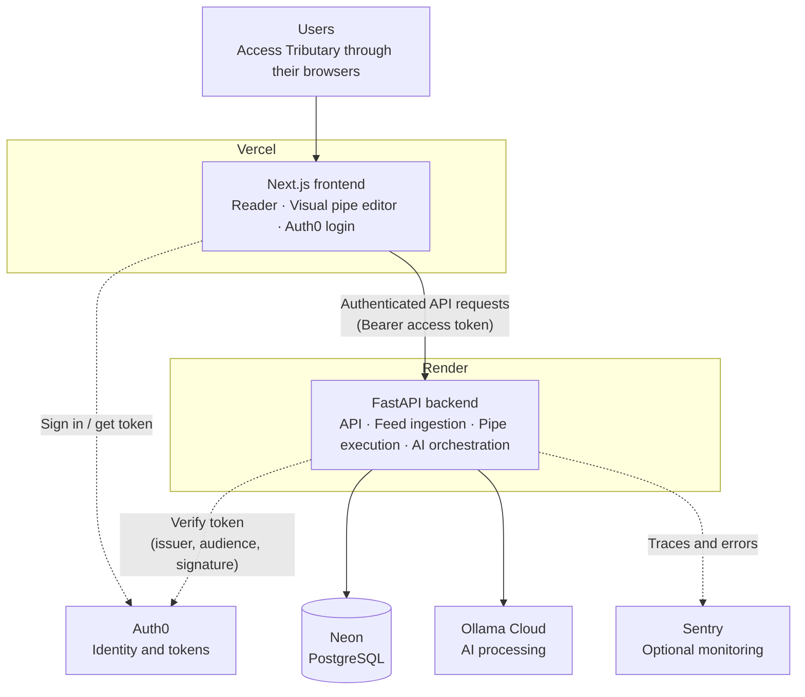
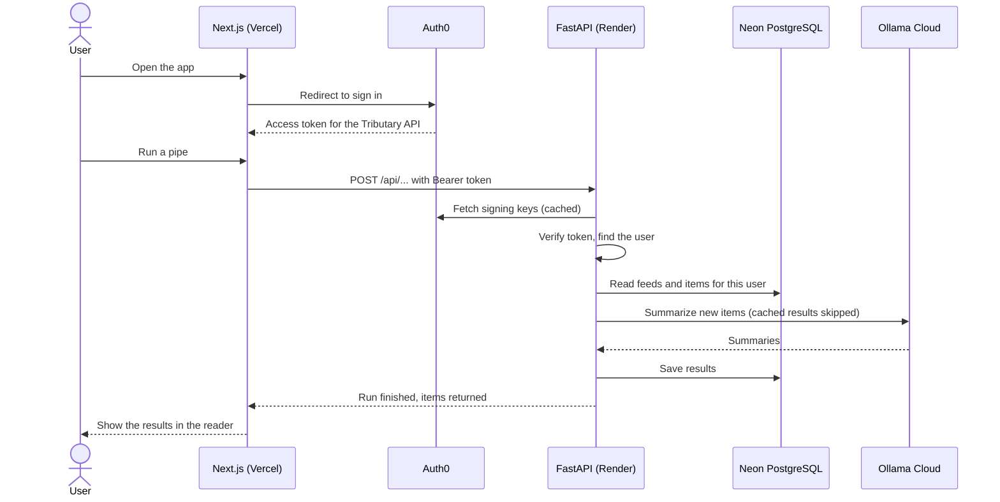
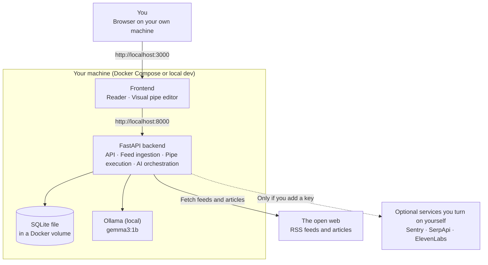
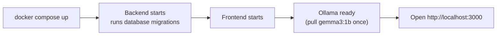

*This is a submission for the [Hacktoberfest Open-Source AI Challenge Week 4: Ghost in the Machine](https://dev.to/challenges/hacktoberfest-week4-2026-10-26)*

Google Reader closed in 2013. Yahoo Pipes closed in 2015. Nothing has replaced either of them, and I have been quietly annoyed about it ever since.

Reader was the calm inbox: unread counts, stars, `j` and `k`, no algorithm deciding what I saw. Pipes was the clever one: drag a few boxes onto a canvas, wire them together, and get a brand-new feed out the other end. Both were killed because someone else owned the server.


## What I Built

- A reader (Google Reader's quiet inbox) plus a canvas (Yahoo Pipes' wiring) in one app. The pipe is the main object. The reader is where its output lands.
- 11 boxes. Three of them use Gemma through Ollama: **Summarize**, **Filter by meaning**, **Why you'd care**. The self-hosted default is `gemma3:1b`; the hosted profile can use `gemma4:31b-cloud`.
- Two ways to run it: self-hosted, with one SQLite file and no accounts, or hosted, with PostgreSQL, Auth0 accounts and a private library per user.
- **Private article sharing.** On the hosted build, send one article as a single-use link. The recipient claims their own snapshot in a **Shared with me** inbox without subscribing to the sender's feed, and their read, star and label state stays theirs.

So for the "Ghost in the Machine" challenge, I revived the Ghost!
**Tributary** is a feed reader whose feeds you shape with a visual pipe builder, with a Gemma model inside as one of the boxes.
Two dead products, one app. Here is what I kept from each:

| Ghost                     | What it was                             | What Tributary keeps                                                                                                                            |
| ------------------------- | --------------------------------------- | ----------------------------------------------------------------------------------------------------------------------------------------------- |
| Google Reader (gone 2013) | A quiet inbox for the sites you chose   | Views for All, Unread and Starred, labels, per-feed unread counts, and keyboard shortcuts (`j`/`k`, `o`, `s`, `m`, `r`, `/`). No ranking, ever. |
| Yahoo Pipes (gone 2015)   | Wire boxes together to reshape a stream | A React Flow canvas at `/pipes`. Drag boxes, connect them, run, inspect every step, and publish the result back into the reader as a feed.      |

A pipe is an ordered list of boxes, and every box takes a list of items and returns a list of items. That one rule is the whole engine.

| Group     | Boxes                                                                                  |
| --------- | -------------------------------------------------------------------------------------- |
| Sources   | `fetch` (your stored feeds), `search` (SerpApi, for the web beyond your subscriptions) |
| Combine   | `merge`, `dedupe`                                                                      |
| Transform | `filter`, `sort`, `limit`                                                              |
| Enrich    | `fulltext` (fetch and extract the article body)                                        |
| Local AI  | `summarize`, `meaning`, `whycare`                                                      |

A pipe I actually use looks like this on the canvas:

```text
fetch (Hacker News + 3 blogs) -> dedupe -> fulltext -> meaning ("practical engineering, no hype") -> summarize -> sort -> limit
```

Run it and it comes back as a feed in the reader, in order, with one-sentence summaries. That is the Pipes idea finally sitting inside the Reader idea.

**The same engine got a hosted front door.** The hosted build keeps the same service layer but adds the things a public reader needs: PostgreSQL instead of a local file, an owner on every feed, label and pipe, and Auth0 in front.

The accounts use an Auth0 **Regular Web Application**, not a single-page app. The Next.js server holds an encrypted, rolling session; the browser asks a small `/auth/access-token` route for a short-lived token only when it calls the FastAPI API. The API validates that token against the tenant's JWKS, checks issuer, audience and expiry, and scopes every query to the authenticated user. Ask for someone else's feed by id and you get a 404, not a peek. The landing page offers **Create account** and **Sign in**, with `screen_hint=signup` for registration, and the reader and pipes routes sit behind the same account gate. The self-hosted build mounts none of it, so the original account-free page is unchanged.

**Sharing is a link, not an email address.** A share starts from one article; Tributary snapshots that item and returns a `/shared/<token>` URL. The raw token is shown once and stored only as a SHA-256 hash, links expire after 30 days and can be claimed once. There is no recipient lookup and no email delivery.

**The recipient gets a copy, not a window into the sender's reader.** Claiming puts an independent snapshot in a virtual **Shared with me** feed. It appears in All, Unread and Starred like any other item, but the inbox is its own feed kind, so it never shows up under RSS or pipe feeds. The copy keeps the article content and provenance; read, star, label and keep/drop decisions stay local to each person. Deleting the sender's feed does not break the share: the snapshot lives in the `shares` row, so a later claim still works. The claim is a conditional database update, so two people holding the same link cannot both receive a copy. The recipient must sign in to the same deployment, and sharing is hidden in local mode because a single-user SQLite install has no second account to claim the link.

The hosted profile is highly rate-limited, because an open signup with an AI model and a search API behind it is a bill waiting to happen. A `usage_events` table counts feed refreshes, pipe runs and searches in a rolling one-hour window. The defaults are 5 saved pipes, 3 pipe runs per hour, 3 searches per hour and 10 feed refreshes per hour. Cached searches do not consume a search slot, a pipe-feed refresh counts as a pipe run, and the API answers with `429` and `Retry-After` when a window is full. Local mode ignores every quota.

## Demo

Tributary is live at [**tributaries.tech**](https://tributaries.tech). You authenticate with Auth0, add a feed, and build a pipe in the browser. Open any article and choose **Share** to send a private, single-use snapshot to a second account; it lands in **Shared with me**. Signup is open. Each account gets its own library and the fixed rolling quotas above.

If you would rather keep everything on your own machine, the self-hosted build still takes about ten minutes. You need Python 3.10+, [uv](https://docs.astral.sh/uv/), Node with pnpm, and [Ollama](https://ollama.com).

```bash
git clone https://github.com/Ekomjah/tributary
cd tributary
ollama pull gemma3:1b
cp .env.example .env

cd backend
uv sync
uv run tributary init-db
uv run tributary serve
```

In a second terminal:

```bash
cd frontend
pnpm install
pnpm dev
```

Or run `make setup`, then `make dev`, to spin it all up quickly.

Open `http://localhost:3000`, click **Add feed**, and paste `https://news.ycombinator.com/rss`. Paste a blog's homepage instead and Tributary will look for its feed. Then run `uv run tributary doctor` to see what is wired up.


Three things are optional, and all are off until you configure them:

- `SERPAPI_API_KEY` turns on the `search` box feature in the pipes.
- `SENTRY_DSN` turns on tracing, so you can watch each pipe run as a trace.
- `OLLAMA_CLOUD=true` with `OLLAMA_API_KEY` swaps the local model for `gemma4:31b-cloud` on Ollama Cloud. That sends article text and prompts off the machine, so it is a deliberate opt-in.

A free-tier key for SerpApi or Sentry is enough to try those features.

## Code
The entire code for Tributary can be viewed on [GitHub](https://github.com/Ekomjah/tributary)

## How I Built It

| Layer             | Choice                                                       | Job                                                |
| ----------------- | ------------------------------------------------------------ | -------------------------------------------------- |
| Reader and editor | Next.js 16, React 19, TanStack Query, Tailwind 4, React Flow | Feed list, article view, drag-and-wire canvas      |
| API and engine    | Python, FastAPI, Pydantic, SQLAlchemy                        | Validate and run pipes, serve the reader           |
| Ingestion         | feedparser, httpx, trafilatura                               | Read feeds, extract readable article text          |
| Storage           | SQLite self-hosted; PostgreSQL hosted                        | Feeds, items, labels, pipes, runs, users, usage    |
| Identity          | Auth0 Regular Web Application                                | Hosted sessions, access tokens, per-user libraries |
| Sharing           | `shares` rows, SHA-256 token hashes, JSON snapshots          | Single-use article links that survive deletion     |
| Quotas            | `usage_events`, rolling one-hour window                      | Keep an open hosted signup bounded                 |
| Local model       | Ollama running `gemma3:1b`                                   | Summaries, meaning filter, relevance notes         |
| Web search        | SerpApi, opt-in                                              | Results beyond your subscribed feeds               |
| Monitoring        | Sentry, opt-in                                               | Traces per run, metrics, GenAI spans               |

**A box is a small list transform.** This is the shape of every one of them:

```python
class WhyCareBox:
    box = "whycare"

    def run(self, items: list[ItemOut], context: RunContext) -> list[ItemOut]:
        ...
```

Because every box has the same signature, boxes compose in any order, and each one is easy to test. The backend validates a pipe's JSON with strict Pydantic models before a run starts, so unknown keys and bad values are rejected up front.

**The model's job is small and the failure mode is boring.** I did not want a 1B model making decisions it cannot be trusted with, so the boxes lean toward keeping things:

- **Summarize** reads the extracted full text and stores one sentence. An item with no full text is skipped without a model call, so it never summarizes a stub.
- **Filter by meaning** judges the best available text against a criterion you write in plain English. An item with no text is kept, not silently dropped.
- **Why you'd care** is handed your latest starred titles as context and writes one sentence on why the story matters to you.

Answers are cached by `(item, box, params hash, model)`. The hash includes a prompt version and a SHA-256 of the text, so an edited article or a changed criterion misses the cache, and repeating a run is free. That matters on a CPU-only laptop. Model errors report the host and failure type, never the prompt or the article. On the hosted profile, the same boxes can use Ollama Cloud when configured; self-hosted defaults to the local model.

**Search in human language and not in keywords.** The app also allows search through SerpAPI in human language instead of just merely bullet points. Gemma then breaks this human-like search query into keywords for better parsing and context during search. For example, you write "AI regulation this week" and Gemma rewrites it into a structured query before SerpApi sees anything:

```text
"AI regulation this week"
        |
        v
Ollama refinement (local, or configured cloud model) -> q, engine, gl, hl, freshness, max_results
        |
        v
SerpApi (cloud, opt-in)
        |
        v
normalize -> items -> six-hour cache -> pipe / reader
```

The refinement uses a Pydantic schema at temperature 0, an allowlisted set of engines, clamped result counts, and a fallback to your raw query if Ollama is down or returns bad JSON. The CLI prints the query it sent, so you can see what the model did to your words.

The app also lets you search through SerpAPI in natural language instead of just bullet points. Gemma then breaks these human-like search terms down for better parsing and context during search


Also, Sentry Agent Tracing helped me catch many hidden bugs in my application. For example, when I was trying to wire OLLAMA_CLOUD as an alternative to running the model locally on-device, I erroneously set the model to `gemma4:3b` instead of `gemma4:31b`, and the app didn't throw any error till i ran the model; With Sentry, I was able to catch this error faster and understand it better. Here's a sneak peek into my Sentry Agent Tracing:
 


# How Tributary runs

Tributary has two ways to run, and they share the same code. The **hosted** version is for people who want to sign in and use it from a browser. The **self-hosted** version is for people who want everything on their own machine, with no account and no data leaving it.

| | Hosted | Self-hosted |
| --- | --- | --- |
| Where it runs | Vercel (frontend), Render (backend), Neon (database) | Your machine, usually with Docker |
| Sign-in | Auth0 | None by default (optional password) |
| Database | PostgreSQL on Neon | SQLite file |
| AI boxes | Ollama Cloud (opt-in, text leaves your machine) | Local Ollama, `gemma3:1b` by default |
| Monitoring | Sentry (optional) | Sentry (optional, off by default) |

---

## Hosted version



### What each part does

- **Users** open Tributary in a normal browser. Nothing to install.
- **Next.js frontend (Vercel)** is the reader and the visual pipe editor. It sends users to Auth0 to sign in, then calls the backend with the access token it receives.
- **FastAPI backend (Render)** does the real work: it stores feeds and items, fetches and cleans articles, runs pipes box by box, creates single-use share links, and calls the AI service when a pipe contains an AI box.
- **Neon (PostgreSQL)** stores feeds, items, pipes, runs, labels and shares. Every row belongs to a user, so one person never sees another person's data.
- **Ollama Cloud** runs the AI boxes (summarize, filter by meaning, why you'd care). In hosted mode, article text is sent to it.
- **Auth0** handles identity. The backend never sees a password. It only checks that the token is genuine, meant for Tributary's API, and not expired.
- **Sentry** is optional. When turned on, each pipe run is a trace and each box is a span.

### A request, step by step



### Things to know

- **Two database addresses.** The app uses the *pooled* Neon address for normal requests. Migrations use the *direct* address.
- **CORS.** The backend only accepts browser requests from the frontend's exact address (`https://tributaries.tech`, and `www` if you use it).
- **Cold starts.** On small Render plans, the backend can take a while to wake up after it has been idle.
- **Privacy.** Hosted mode sends article text to Ollama Cloud. Self-host if you don't want that.

---

## Self-hosted version



### What each part does

- **Browser** talks to the app on `localhost`. By default the app only listens on your own machine (`127.0.0.1`), so nobody else on your network can reach it.
- **Frontend and backend** are the same code as the hosted version, running side by side.
- **SQLite** is a single file that holds your feeds, stars, labels, pipes and results. In Docker it lives in a named volume, so it survives restarts and updates.
- **Ollama** runs `gemma3:1b` on your own CPU. Article text for the AI boxes never leaves your machine.
- **The open web** is the only outside traffic by default: the app fetches the feeds and articles you subscribe to.
- **Optional services** (Sentry monitoring, SerpApi search, ElevenLabs voices) are off until you add their keys.

### How it starts


---

## Choosing between them

- Pick **hosted** if you want to open a link and start reading, from any device.
- Pick **self-hosted** if you want full privacy, offline AI, and complete control of your data.

**Privacy is spelled out, not implied.**

| What                                        | Where it goes                                                                                                                                                                            |
| ------------------------------------------- | ---------------------------------------------------------------------------------------------------------------------------------------------------------------------------------------- |
| Feeds, items, stars, labels, extracted text | A local SQLite file when self-hosted; PostgreSQL in your hosted account                                                                                                                  |
| Article text for AI boxes                   | Your local Ollama by default; Ollama Cloud only if you opt in                                                                                                                            |
| Auth0                                       | Email and profile for hosted sign-in; the API receives a short-lived access token                                                                                                        |
| Share links                                 | The article snapshot and the sender's name, or email when no name is set, live in a `shares` row; only a SHA-256 hash of the token is stored, and the raw link is shown once             |
| SerpApi                                     | The refined query and options. Never article text or reading history                                                                                                                     |
| Sentry                                      | Nothing unless you set a DSN. With a DSN it captures request data and, by default, GenAI prompts and responses; every category has a switch. API keys and URL query strings are redacted |

## What Broke

**Feeds don't agree on what a feed contains.** Some publish the whole article inside the XML. Others publish a title and a link and nothing else, and there is no way to guess which you will get. I did not want a reader that sends you to another site for every second story, so Tributary stores what the feed gives it, and when that is only an excerpt it fetches the page, extracts the body with `trafilatura`, cleans it with `BeautifulSoup`, and stores sanitized HTML for the reader to display.

**My first summaries summarized nothing.** The Hacker News feed does not contain the articles. Each entry is a title and a line that says `Article URL: https://...`. So my first Summarize box was faithfully summarizing a link. The fix was the `fulltext` box, which fetches the page and extracts the body with trafilatura, and a rule that Summarize only reads real text.

**A blog URL "worked" and gave me nothing.** I pasted a blog's homepage, got a 200 response, zero items, and a healthy-looking feed. I asked a coding agent to audit my fetcher and it returned **34 findings**. The worst one was exactly this: an HTML page was being counted as a successful fetch. The fetcher now checks that the response really is a feed, rejects empty bodies and HTML pages, follows redirects one hop at a time and re-checks every hop so a public feed cannot bounce into a private address, caps responses at 2 MB, and has a discovery step that finds a feed from a blog URL.

**Apostrophes arrived as `&#8217;`.** Feed text carries HTML entities, and my cleanup skipped short snippets. Titles and summaries are now normalised, and feed HTML is sanitised before storage.

**The hosted front door still said "private beta."** The reader had a working sign-in gate, but the copy told visitors to use the account they were invited with while signup was already open, and the landing page only offered **Open the reader**. The fix was to make the gate and the landing page say **Create account** and **Sign in**, keep the local page untouched, and let Auth0 open the signup screen with `screen_hint=signup`.

**A share link is not the article URL.** The obvious implementation hands the recipient the item's `link` and lets them subscribe to the sender's feed. That breaks as soon as the feed is deleted, and it shares a subscription when the sender meant to share one story. The fix was a separate `/shared/<token>` URL backed by a snapshot in the `shares` row. The raw token is shown once and stored only as a SHA-256 hash; the claim is a conditional `UPDATE ... WHERE claimed_at IS NULL`, so two people cannot both redeem it. Links expire after 30 days, and because the copy comes from the snapshot, a claim still works after the source item is gone.

## Why Does Open Innovation Matter?

Google Reader and Yahoo Pipes are not gone because they were bad. They are gone because they lived on someone else's server and that someone changed their mind. That is the whole argument for open, and it shaped Tributary:

- **A pipe is a JSON file.** You can save it, diff it, share it, and run it from the CLI with no browser. Self-hosted means your pipes and your data survive the project.
- **Your library is yours.** Self-hosted, it is one SQLite file. Hosted, every feed, label and pipe carries your owner id, so the library is scoped to your account in PostgreSQL.
- **A share does not need a platform.** A link carries one article to one reader; there is no social graph and no inbox owned by someone else, and the recipient's copy is theirs to keep.
- **It works with the lights off.** With Ollama local, the summaries, the meaning filter, and the query rewriting need no internet. Only fetching the feeds themselves does.
- **Your reading stays yours.** In the default local setup, article text goes to a model on your own machine. Nothing reconstructs your reading history on someone else's disk.
- **The model is a setting.** `OLLAMA_MODEL` swaps it in the local build; `OLLAMA_CLOUD_MODEL` does the same for the cloud model. A bigger model on a better machine is one environment variable away.
- **It costs nothing per summary.** Self-hosted, the only meter running is my laptop fan. Hosted, the meter is a fixed quota rather than a surprise bill.

**Where a closed model would be better.** A frontier model would almost certainly judge "is this practical engineering without hype?" better than a 1B model, and would write sharper summaries. I have not measured the gap, so I will not put a number on it. The honest trade is quality against ownership, and for a tool I want to still have in ten years, I chose ownership. There is also an opt-in cloud model (`gemma4:31b-cloud` through Ollama Cloud) for people who want a stronger model.

## My Agent Session
Tributary was built in a human-agent collaborative effort where my agent (OpenCode) wrote most of the code while I stood behind to monitor its output, guide it through decisions and decide the design language for the app



## The Spirit of It

Google Reader was shut down in 2013. I built the laptop I used this on that same year. It has outlived the tool I was trying to bring back, and it runs a feed reader and `gemma3:1b` just fine. All that matters is that the machine is old enough to remember these OG tools.

I wanted Tributary to feel like a reader from that era: white page, blue headlines, a sidebar of unread counts, one red button. I also wanted a model in it that stays out of your way. Reader and Pipes both made the open web feel like something you could arrange yourself. Then the servers were turned off, and the habit went with them. The self-hosted build runs on your machine, so no server can be turned off by anyone else. The hosted build is for people who don't want to run a server, and it keeps the same quiet reader.

## Prize Categories

- **Best Use of Gemma.** In the self-hosted default, every AI box runs on `gemma3:1b` locally through Ollama: Summarize, Filter by meaning, Why you'd care, and the search query refinement. That default works fully offline. The hosted profile can opt into `gemma4:31b-cloud` through Ollama Cloud for a larger model.
- **Best Use of Sentry Agent Tracing.** One trace per pipe run with a span per box (item counts, duration), plus `gen_ai.chat` spans with model and token counts for every AI and refinement call, and feed-refresh and search metrics. Keys and URL query strings are redacted. Without a DSN nothing is sent; with a DSN, `SENTRY_COLLECT_GEN_AI` defaults to true, so prompts and responses are captured unless you turn that category off.
- **Best Use of SerpApi.** `search` is a real source box, not a bolt-on. The configured model refines the query, SerpApi fetches results, they are cached for six hours, and a fallback keeps it working if the refinement fails. Search is off unless a key is set. On the hosted profile, it is capped at 3 searches per hour by default, and cached searches do not use a slot.
- **Best Use of .tech domain.** The app is live at [tributaries.tech](https://tributaries.tech) with Auth0 accounts, per-user PostgreSQL libraries and rolling quotas. Billing and plans are not implemented yet.
- **Best Use of Render** The FastAPI backend runs on Render with all it's secrets stored therein

I hope you get to try Tributary and tell me what you think about it below in the comments!
